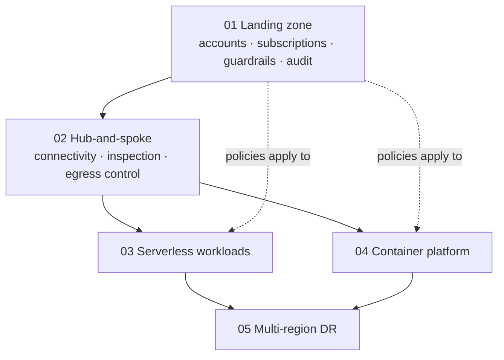

# Cloud solution architectures: AWS and Azure

[](https://github.com/santoshmyakala/cloud-solution-architectures/actions/workflows/ci.yml)


Five reference architectures, each designed **for both AWS and Azure**, so the trade-offs between the clouds are explicit. Three of them are **deployable Terraform on both clouds**, with offline `terraform test` suites that assert the security and reliability properties the design depends on. All five have diagrams, decisions and Well-Architected mapping.

| # | Architecture | AWS | Azure | Status |
|---|---|---|---|---|
| 01 | [Landing zone and guardrails](architectures/01-landing-zone) | Organizations, OUs, SCPs, org CloudTrail | CAF management groups, Azure Policy, Log Analytics | **Terraform + tests (both)** |
| 02 | [Hub-and-spoke network with inspection](architectures/02-hub-spoke-network) | Transit Gateway, Network Firewall, NAT | Hub VNet, Azure Firewall Premium, UDRs | **Terraform + tests (both)** |
| 03 | [Serverless event-driven intake](architectures/03-serverless-event-driven) | API Gateway, Lambda, SQS + DLQ, DynamoDB | Functions Flex, Service Bus, Cosmos DB, managed identity | **Terraform + tests (both)**, function code unit-tested |
| 04 | [Kubernetes application platform](architectures/04-container-platform) | EKS, Karpenter, Pod Identity | AKS, NAP, Workload ID | Design; delivery implemented in [devsecops-gitops-pipeline](https://github.com/santoshmyakala/devsecops-gitops-pipeline) |
| 05 | [Multi-region resilience and DR](architectures/05-multi-region-dr) | Route 53, Aurora Global, AWS Backup | Front Door, SQL failover groups, Azure Backup | Design |

## How the pieces fit



## Service mapping

| Capability | AWS | Azure |
|---|---|---|
| Account / subscription hierarchy | Organizations, OUs | Management groups |
| Preventive guardrails | Service control policies | Azure Policy (deny) |
| Audit trail | CloudTrail (organization trail) | Activity Log → Log Analytics |
| Hub routing | Transit Gateway | VNet peering + UDRs (or Virtual WAN) |
| Managed firewall | AWS Network Firewall | Azure Firewall |
| HTTP API front door | API Gateway (HTTP API) | API Management / Functions HTTP trigger |
| Functions | Lambda | Azure Functions (Flex Consumption) |
| Queue | SQS (+ DLQ) | Service Bus queues (+ dead-letter) |
| NoSQL | DynamoDB | Cosmos DB |
| Kubernetes | EKS | AKS |
| Workload identity | IAM roles, EKS Pod Identity | Managed identity, Entra Workload ID |
| Global traffic | Route 53, Global Accelerator, CloudFront | Front Door, Traffic Manager |
| Observability | CloudWatch, X-Ray, Managed Prometheus | Azure Monitor, Application Insights, Managed Prometheus |
| Threat detection | GuardDuty, Security Hub | Defender for Cloud |

## Well-Architected coverage

| Pillar | Where it shows up |
|---|---|
| Security | Deny guardrails (01), no direct egress + IDPS (02), least-privilege roles and key-less auth (03), signed images (04) |
| Reliability | Multi-AZ/zone-redundant firewalls (02), DLQ + idempotency + PITR/continuous backup (03), DR ladder (05) |
| Operational excellence | Everything as code with tests and CI; alarms on DLQs; ADRs for decisions |
| Performance efficiency | Serverless and on-demand capacity (03), Karpenter / node auto-provisioning (04) |
| Cost optimisation | Pay-per-request data stores, scale-to-zero compute, cost notes per architecture, tag policies for chargeback (01) |
| Sustainability | arm64 (Graviton) Lambdas, scale-to-zero, right-sized nodes |

Architecture decisions: [docs/adr](docs/adr).

## Testing approach

Every Terraform stack has a `tests/*.tftest.hcl` suite that runs **without cloud credentials**: providers are mocked, and assertions check intent rather than syntax. Examples:
- spokes have no internet route;
- every Azure spoke route points at the firewall;
- each AWS AZ uses its own firewall endpoint;
- no key-based auth on Service Bus, Cosmos DB or Storage;
- the ingest Lambda can't touch DynamoDB;
- SCPs exempt global services from region restriction.

```bash
cd architectures/02-hub-spoke-network/azure && terraform init -backend=false && terraform test
```

| Stack | Tests |
|---|---|
| 01 AWS / Azure | 3 / 4 |
| 02 AWS / Azure | 3 / 2 |
| 03 AWS / Azure | 2 / 3 · plus 5 Python handler tests |

CI runs `fmt`, `validate`, `terraform test`, TFLint and a Trivy IaC scan for each stack, plus the Python tests and a gitleaks secret scan.

## Licence

MIT
