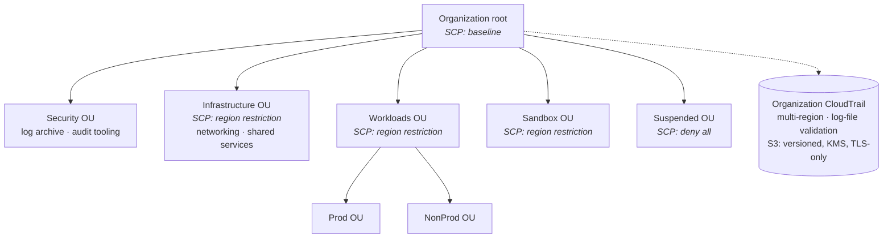
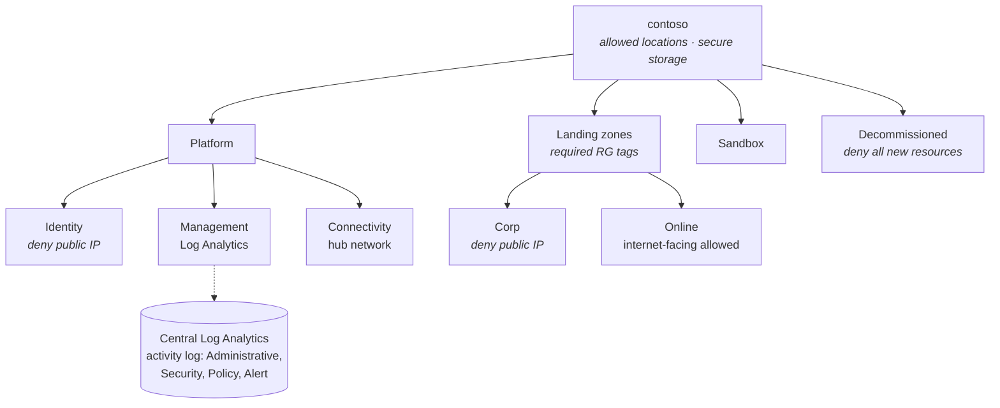

# 01 · Landing zone and governance guardrails

**Problem:** give many teams their own cloud accounts or subscriptions quickly, without each team re-solving identity, audit and baseline security, and without central teams becoming a bottleneck.

**Approach:** a hierarchy (OUs / management groups) that groups workloads by **policy**, not by org chart. **Preventive guardrails** sit at the highest sensible level, and **central, immutable audit logging** is in place from day one.

## AWS: Organizations + SCPs



| Guardrail (SCP) | Why |
|---|---|
| Deny `organizations:LeaveOrganization` | Accounts can't escape governance |
| Deny stopping/deleting CloudTrail, GuardDuty, Config, Security Hub | Attackers' first move is to blind you |
| Deny all actions by the root user | Root is break-glass only |
| Deny `ec2:RunInstances` unless IMDSv2 is required | Blocks SSRF-to-credential theft (the Capital One class of incident) |
| Deny non-global actions outside approved regions | Data residency (GDPR) and a smaller attack surface; IAM, Route 53, CloudFront etc. exempt |
| Deny everything in *Suspended* | Quarantine before account closure |

## Azure: management groups + Azure Policy (CAF enterprise-scale)



| Guardrail (custom policy, effect = deny) | Scope |
|---|---|
| Allowed locations (Sweden Central, West/North Europe, plus `global`) | Root |
| Storage: HTTPS only, TLS 1.2, no anonymous blob access | Root |
| Resource groups must carry `owner`, `environment`, `costCenter` | Landing zones |
| No public IP addresses | Corp, Identity |
| No new resources | Decommissioned |

## Design decisions

- **Prevent rather than detect** where the rule is unambiguous. Detective controls (Security Hub, Defender for Cloud) still sit on top for posture scoring.
- **Corp vs online** (Azure) and **Prod vs NonProd** (AWS) exist because they need *different policies*, not because of team boundaries.
- **The Security OU is exempt from region restriction**, so security tooling can operate in every region an attacker might use.
- Policies are written as **code with tests**: `terraform test` asserts the hierarchy, the attachment points and the policy content, offline.

## Deploy

```bash
cd aws && terraform init && terraform apply -var trail_bucket_name=<unique-name>       # management account
```

```bash
cd azure && terraform init && terraform apply -var management_subscription_id=<sub-id>  # tenant-root permissions
```
