# 02 · Hub-and-spoke network with central inspection

**Problem:** many workload networks need internet egress, shared services and controlled east-west traffic, without each team running (and misconfiguring) its own firewall.

**Approach:** spokes have **no direct internet path**. All traffic, including spoke-to-spoke, is routed through a central, highly available firewall with an **egress allowlist** and centralised logs.

## AWS: Transit Gateway + inspection VPC + AWS Network Firewall

<picture>
  <source media="(prefers-color-scheme: dark)" srcset="diagrams/aws-dark.svg">
  
</picture>

## Azure: hub VNet + Azure Firewall Premium

<picture>
  <source media="(prefers-color-scheme: dark)" srcset="diagrams/azure-dark.svg">
  
</picture>

## Same pattern, different mechanics

| Concern | AWS | Azure |
|---|---|---|
| Hub router | Transit Gateway with separate route tables (no default propagation) | VNet peering + user-defined routes |
| Firewall | AWS Network Firewall, one endpoint per AZ | Azure Firewall Premium, zone-redundant |
| Flow symmetry | TGW **appliance mode** + per-AZ routing | Single logical firewall IP |
| Egress control | Stateful domain allowlist (TLS SNI / HTTP Host) | Application rules on FQDNs + DNS proxy |
| Threat detection | Suricata-compatible rules (add managed threat signatures) | IDPS + threat intelligence in **deny** mode |
| Stop implicit egress | No IGW in spokes | `default_outbound_access_enabled = false` |

## Tests assert

- Spokes can't reach the internet directly (no IGW routes, no public IPs, no implicit outbound).
- Every spoke route points at the firewall, including routes to the other spoke.
- Each AWS AZ is steered through **its own** firewall endpoint (checked with a mocked apply).
- Firewall posture: allowlist, IDPS/threat intelligence blocking, zone redundancy.

## Cost note

Firewalls and NAT gateways are the dominant fixed costs: roughly hundreds of USD per month per AZ or firewall before data processing. For non-production, share one hub or use a single AZ.
