# 03 · Serverless, event-driven order intake

**Problem:** accept orders over HTTP with unpredictable spikes, never lose an accepted order, and pay nothing when idle.

**Approach:** an API that **validates and enqueues** (fast 202), a queue that **absorbs bursts**, a worker that writes **idempotently**, and poison messages that go to a **dead-letter queue** with an alarm.

## AWS

<picture>
  <source media="(prefers-color-scheme: dark)" srcset="diagrams/aws-dark.svg">
  
</picture>

## Azure

<picture>
  <source media="(prefers-color-scheme: dark)" srcset="diagrams/azure-dark.svg">
  
</picture>

## Decisions

| Decision | Reason |
|---|---|
| Validate at the edge, process asynchronously | The client gets a fast 202 and the worker scales independently |
| Idempotent writes (`attribute_not_exists` / upsert by id) | Queues deliver **at least once** |
| Partial batch failure reporting (AWS) | One bad record doesn't make nine good ones retry |
| Five attempts, then dead-letter, then alarm | Bounded retries; humans look at true poison messages |
| **No keys anywhere (Azure):** Service Bus, Cosmos DB and Storage reject key auth; the function uses managed identity with queue- and container-scoped roles | Nothing to leak or rotate |
| One IAM role per Lambda, with only the actions it needs | Blast radius of a compromised function is one queue or table |

## Tests

- `terraform test` (both clouds): reliability settings, least privilege (no wildcards, ingest can't touch the database, RBAC scopes), and on Azure that **no key-based auth** is enabled anywhere.
- `pytest app_tests/`: handler behaviour with fakes (validation, 202 path, partial-failure reporting, duplicate handling), and that **validation rules are identical on both clouds**.

## Deploy the Azure function code

```bash
cd azure/function_app && func azure functionapp publish func-orders --python
```
