# 04 · Kubernetes application platform (EKS / AKS)

**Problem:** give product teams a self-service, secure, observable way to run containers, while the platform team owns upgrades, security baselines and cost.

> **Reference architecture** (design level). The delivery and admission-control parts are implemented and tested in [devsecops-gitops-pipeline](https://github.com/santoshmyakala/devsecops-gitops-pipeline); the workload is [wine-quality-mlops](https://github.com/santoshmyakala/wine-quality-mlops).

<picture>
  <source media="(prefers-color-scheme: dark)" srcset="diagrams/platform-dark.svg">
  
</picture>

Animated diagram generated from <a href="diagrams">diagrams/*.yaml</a> with <a href="https://github.com/santoshmyakala/santoshmyakala/tree/main/tools/archdiagram">archdiagram</a>.

## Building blocks

| Capability | AWS (EKS) | Azure (AKS) |
|---|---|---|
| Control plane access | Private endpoint + access entries (IAM) | Private cluster + Entra ID RBAC, local accounts disabled |
| Pod → cloud identity | EKS Pod Identity / IRSA | Microsoft Entra Workload ID |
| Node scaling | Karpenter (spot + on-demand mix) | Node auto-provisioning (Karpenter-based) / cluster autoscaler |
| Ingress | AWS Load Balancer Controller (ALB) + WAF | Application Gateway for Containers + WAF |
| Secrets | Secrets Manager via External Secrets / CSI driver | Key Vault via CSI driver |
| Registry | ECR with scan on push, immutable tags | ACR Premium, private endpoint, content trust / Notation |
| Policy | Kyverno (signature, pod security) | Kyverno or Azure Policy for AKS (Gatekeeper) |
| Runtime threat detection | GuardDuty EKS Runtime Monitoring | Defender for Containers |
| Observability | Amazon Managed Prometheus + Grafana, CloudWatch Container Insights | Azure Monitor managed Prometheus + Managed Grafana |
| Upgrades | Managed node groups / Karpenter drift; blue-green node pools | Auto-upgrade channel + planned maintenance windows |

## Multi-tenancy model

| Layer | Control |
|---|---|
| Namespace per team per environment | ResourceQuota, LimitRange |
| Network | Default-deny NetworkPolicy; explicit allows |
| Admission | Signed images only, non-root, no privilege escalation, limits, probes |
| Identity | Separate workload identity per service account |
| Cost | Namespace and label-based allocation (Kubecost / OpenCost) |

## Key decisions

1. **GitOps (pull) over CI push** to clusters: clusters hold no CI credentials, and drift self-heals.
2. **Admission control is the last line of defence.** Shift-left scans catch issues early; the cluster still refuses anything unsigned or unsafe.
3. **Karpenter-style provisioning** over static node groups: right-sized nodes and spot capacity for stateless workloads.
4. **No static cloud credentials in pods**: workload identity only.
