# 05 · Multi-region resilience and disaster recovery

**Problem:** pick the cheapest DR strategy that meets the business's **RTO** (how long you can be down) and **RPO** (how much data you can lose). Then prove it works.

> **Reference architecture** (design level).

## Strategy ladder

| Strategy | Typical RTO / RPO | Relative cost | AWS building blocks | Azure building blocks |
|---|---|---|---|---|
| Backup & restore | hours / hours | $ | AWS Backup cross-region copy, IaC to rebuild | Azure Backup cross-region restore, IaC to rebuild |
| Pilot light | tens of minutes / minutes | $$ | Aurora Global DB or DynamoDB global tables; infra defined but scaled to zero | Azure SQL failover groups, Cosmos DB multi-region; minimal compute |
| Warm standby | minutes / seconds | $$$ | Scaled-down full stack in region 2; Route 53 failover | Scaled-down stack; Front Door priority routing |
| Active-active | ~0 / ~0 (conflict handling required) | $$$$ | Global Accelerator / Route 53 latency, DynamoDB global tables | Front Door, Cosmos DB multi-region writes |

## Warm standby reference (both clouds)

<picture>
  <source media="(prefers-color-scheme: dark)" srcset="diagrams/dr-dark.svg">
  
</picture>

Animated diagram generated from <a href="diagrams">diagrams/*.yaml</a> with <a href="https://github.com/santoshmyakala/santoshmyakala/tree/main/tools/archdiagram">archdiagram</a>.

## What makes DR real

1. **Failover is automated and rehearsed:** quarterly game days with AWS Fault Injection Service or Azure Chaos Studio, and RTO/RPO measured rather than assumed.
2. **Data first:** choose the replication technology per data store; the compute tier is the easy part.
3. **The DR region is deployed from the same IaC**, with region as a variable. Drift between regions is the most common DR failure.
4. **Dependencies are mapped:** identity, DNS, secrets, container registries and third-party APIs must also survive the region loss.
5. **Failback is planned**, not improvised.
